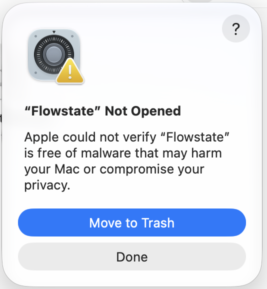
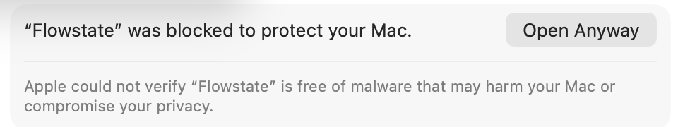

# Flowstate

A timer in your Mac's menu bar, made for people with ADHD. Reserve a block
of time, keep one task in front of you, and watch the time you have left as
liquid in a reservoir. Press Control–Space in any app to open Flowstate, and
again to put it away.

Free. Needs **macOS 27.2 or later** (macOS 27 runs on Macs with Apple
silicon).

## Install

1. Download `Flowstate-<version>.dmg` from the
   [latest release](https://github.com/xyiencefiction/flowstate-releases/releases/latest).
2. Open the DMG and drag **Flowstate** onto **Applications**.
3. Open Flowstate from your Applications folder.

### The first time: "Flowstate" Not Opened

Flowstate is free and made by one person, without Apple's paid developer
program, so Apple has not checked it. The first time you open it, macOS stops it:

Click **Done** (not Move to Trash). Then:

1. Open **System Settings › Privacy & Security**.
2. Scroll down to **Security**. It says "Flowstate" was blocked. Click
   **Open Anyway**:

   

3. macOS asks once more: Open "Flowstate"? Click **Open Anyway**.
4. Use Touch ID, or type your password.

You do this once. Flowstate lives in the menu bar, as a small timer, and a
short welcome shows you around.

**If you like Terminal,** one command does the same, after you dragged the app
into Applications:

    xattr -dr com.apple.quarantine /Applications/Flowstate.app

### New versions

Flowstate checks for a new version about once a day. When one is ready, a
small dot appears on the **Settings** tab inside Flowstate: open
**Settings › About** and click **Install**. You can also ask any time with
**Check Now** in the same place. Updates install inside the app, so you should
not see the "Not Opened" message again, and your tasks, blocks and settings
stay where they are.

## Privacy

In Flowstate's own words (Settings › About):

> Your tasks, blocks and settings stay on this Mac. No account, no analytics.
> Only the update check goes online: it reads a list of versions from GitHub.

- Your tasks, blocks and settings are files in Flowstate's own folder on your
  Mac. No account, no cloud, no analytics.
- About once a day, Flowstate reads a short list of versions from this page
  on GitHub. It downloads a new version only when you click **Install**
  (or if you tick "Automatically download and install updates in the future").

## Found a problem?

Open Flowstate and choose **Settings › About**, and note the version and
build shown there. Then
[open an issue](https://github.com/xyiencefiction/flowstate-releases/issues/new)
on this page with those two numbers and what happened. You need a free GitHub
account. Issues are public, so leave out anything private.
